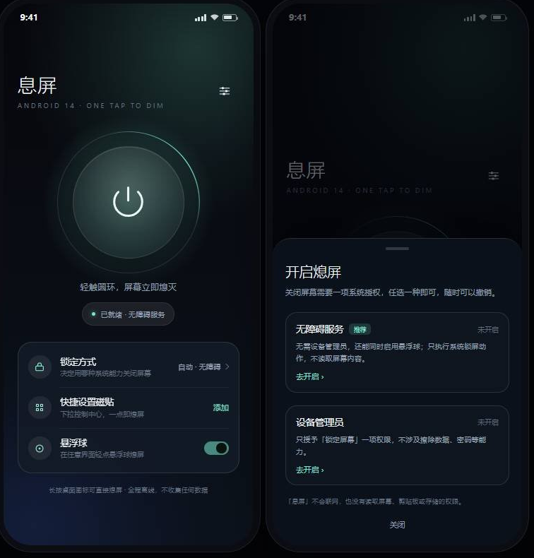

# 息屏 · Dim

<p align="center">
  <strong>One tap. Screen off.</strong><br>
  <em>A focused, privacy-first Android screen lock utility.</em>
</p>

> **中文**：一个只做一件事的 Android 工具：从主界面、快捷设置磁贴、桌面快捷方式或悬浮球一键熄屏。  
> **English**: A focused Android utility that turns the screen off from the main button, Quick Settings tile, launcher shortcut or floating ball.

## 亮点 Highlights

- **四种入口 / Four entry points**：主按钮、快捷设置、桌面快捷方式、悬浮球。
- **两条合法系统通道 / Two legitimate system paths**：无障碍服务与设备管理员，自动回退。
- **隐私优先 / Privacy-first**：无网络、无常驻通知、无存储和位置权限。
- **Android 14 ready**：edge-to-edge、主题图标、预测性返回与显式导出组件。

## Tech stack

`Java` · `Android SDK 34` · `AccessibilityService` · `DevicePolicyManager` · `minSdk 29`

## English

Dim is intentionally small and transparent. Android does not allow ordinary apps to call privileged power APIs, so Dim uses the official `AccessibilityService` lock-screen action and `DevicePolicyManager.lockNow()`, with clear onboarding and automatic fallback. It never uploads data and does not keep a foreground service alive.

> 为 Android 14 设计的一键熄屏应用。轻触圆盘，屏幕立刻熄灭。



设计稿是用 HTML 1:1 复刻的布局示意（`preview/mock.html`），不是真机截图。

---

## 直接安装

APK 已编译、对齐并签名，位于：

```
dist/Dim-1.0.0.apk
```

```
adb install -r dist/Dim-1.0.0.apk
```

- 包名：`com.etherealnymph.dim`
- 版本：`1.0.0`（versionCode 1）
- minSdk 29（Android 10）/ targetSdk 34（Android 14）
- 大小：68,203 字节（约 67 KB）
- 签名：APK Signature Scheme v3（Android 10+ 直接校验）
- SHA-256：`5ae310b7b24f9d6846bf4ad0dbd1a2f006c2e7f003bdda2d19480df01994d49c`

也可以把 APK 传到手机点击安装，按系统提示允许「安装未知应用」。

---

## 四种熄屏入口

| 入口 | 操作 | 依赖 |
| --- | --- | --- |
| 主界面圆盘 | 打开应用，轻触中央圆盘 | 一种授权 |
| 快捷设置磁贴 | 下拉控制中心，点「熄屏」 | 一种授权 |
| 桌面快捷方式 | 长按应用图标 → 「立即熄屏」 | 一种授权 |
| 悬浮球 | 点屏幕边缘的小球 | 无障碍服务 |

主界面还提供「锁定方式」「快捷设置磁贴」「悬浮球」三行设置，以及右上角的完整设置面板。

---

## 它怎么做到「关屏」

Android 不允许普通应用直接调用 `PowerManager.goToSleep()`——那是 `signature|privileged` 权限。普通应用只有两条合法通道：

1. **无障碍服务**：`AccessibilityService.performGlobalAction(GLOBAL_ACTION_LOCK_SCREEN)`（API 28+）。
2. **设备管理员**：`DevicePolicyManager.lockNow()`，只需要 `force-lock` 一项策略。

「息屏」把两者收敛成一个 `LockManager.lock()`，并按用户偏好自动回退：

| 偏好 | 首选可用 | 回退 |
| --- | --- | --- |
| 自动（默认） | 无障碍 | 设备管理员 |
| 无障碍服务 | 无障碍 | 设备管理员 |
| 设备管理员 | 设备管理员 | 无障碍 |

无障碍服务虽然被勾选、但进程没连上时（被系统清理），会自动落到设备管理员；两者都不可用时，界面弹出授权引导而不是静默失败。

> 没有采用 Shizuku / root / `DEVICE_POWER` 方案：前者需要额外安装与授权，后者完全不适合普通用户。

---

## 设计

### 交互

- **只有一个主按钮**。整个圆盘是点击区域（244dp），按下收缩 3.5%，松开扩散一圈冲击波，然后熄屏退出。
- **状态芯片**直接回答「现在能不能用」：已就绪（薄荷绿）／未开启（琥珀色）／无障碍掉线（琥珀色），点击即可修复。
- **授权面板是底部抽屉**，两项授权并列，各自显示「未开启 / 已开启」，不需要在设置迷宫里猜。
- **熄屏后立刻 `finishAndRemoveTask()`**：解锁回到桌面，而不是回到一个没用的空界面。
- **磁贴与快捷方式都是「零界面」路径**：从控制中心或长按图标一步熄屏。

### 视觉

- 深色极光背景：左上薄荷、右下靛蓝两层径向光晕，顶部压暗，衬托中央圆盘。
- 圆盘由三层构成：缓慢旋转的极光弧（36 秒一圈）、内发光圆盘、电源符号；外圈光晕以 2.8 秒呼吸。
- 排版：30sp 细体标题 + 2.8px 字距的英文副标题 + 大圆角卡片；强调色只有一种薄荷绿，警示色一种琥珀色。
- 动效克制：只有圆盘在动，背景是静态的（省电，也避免长时间停留时的视觉噪音）。

### 色彩

| 角色 | 值 |
| --- | --- |
| 背景 | `#06070B → #0C121C` |
| 卡片 | `#121A25` / 描边 `#1FFFFFFF` |
| 主文字 | `#F3F6F9` |
| 次文字 | `#93A0B4` |
| 强调 | `#74E8C8` |
| 警示 | `#E7B778` |

---

## Android 14 适配

- `compileSdk` / `targetSdk` 34，`minSdk` 29。
- **边到边**：`Window.setDecorFitsSystemWindows(false)` + `WindowInsets` 监听，状态栏 / 手势条 / 刘海区域都正确留白。
- **QS 磁贴**：Android 14 上 `startActivityAndCollapse(Intent)` 已废弃，代码走 `PendingIntent` 分支（API 34+）。
- **自适应图标**：提供 `mipmap-anydpi-v33` 的 monochrome 层，支持 Android 13+ 主题图标。
- **没有前台服务、没有通知**：不需要 `POST_NOTIFICATIONS`、`FOREGROUND_SERVICE_*`，也不会有常驻通知。
- **预测性返回**：`enableOnBackInvokedCallback="true"`，底部面板走系统返回手势。
- **组件显式导出**：只有启动 Activity、快捷方式 Activity、设备管理员、无障碍服务、磁贴服务声明 `exported`，并分别用系统签名级权限保护。
- 磁贴使用 `StatusBarManager.requestAddTileService()`（API 33+）引导添加，低版本自动降级为手动提示。

---

## 权限与隐私

| 声明 | 用途 |
| --- | --- |
| `VIBRATE` | 点击圆环的触感反馈，可在设置关闭 |
| 设备管理员 `force-lock` | 仅在用户主动启用时用于 `lockNow()`，可随时撤销 |
| 无障碍服务 | 仅执行系统锁屏动作，`canRetrieveWindowContent=false` |

- **没有 `INTERNET`**：应用无法联网。
- **没有存储、剪贴板、位置、相机、通讯录权限**。
- 所有状态（锁定方式、悬浮球位置、触感开关）只写在本地 `SharedPreferences`。

---

## 首次使用

1. 安装 APK，打开「息屏」。
2. 首次启动会自动弹出授权面板；选择 **无障碍服务 → 去开启**：
   `设置 → 无障碍 → 已下载的应用 → 息屏 → 开启`。
3. 如果系统提示 **「受限设置」**（Android 13+ 对侧载应用的限制）：
   `应用信息 → 右上角 ⋮ → 允许受限设置`，再回到无障碍里开启。
4. 可选：把磁贴加到控制中心（主界面点「添加」）。
5. 可选：在设置里打开「悬浮球」。
6. 可选：用设备管理员作为无障碍之外的第二条通道（设置 → 授权面板 → 设备管理员）。

> 小米 / 华为 / OPPO / vivo 等定制系统可能清理无障碍服务。请在系统设置里给「息屏」允许自启动、并把电池策略设为「不限制」，否则悬浮球和磁贴可能因为服务掉线而回退到设备管理员。

---

## 项目结构

```
DimScreen/
├── app/src/main/
│   ├── AndroidManifest.xml
│   ├── java/com/etherealnymph/dim/
│   │   ├── MainActivity.java            主界面与状态机
│   │   ├── LockManager.java             两条熄屏通道 + 自动回退
│   │   ├── LockAdminReceiver.java       设备管理员（force-lock）
│   │   ├── DimAccessibilityService.java 无障碍锁屏 + 悬浮球
│   │   ├── FloatingBallView.java        可拖拽悬浮球
│   │   ├── LockTileService.java         快捷设置磁贴
│   │   ├── QuickLockActivity.java       桌面长按快捷方式（零界面）
│   │   ├── SetupSheet.java              授权引导底部面板
│   │   ├── SettingsSheet.java           设置面板
│   │   ├── Prefs.java / Haptics.java
│   │   └── ui/                          圆盘、极光背景、呼吸点
│   └── res/                             布局、配色、图标、动画
├── preview/                             设计稿与预览图
├── keystore/                            自签名证书（仅侧载用）
├── dist/Dim-1.0.0.apk                   已签名安装包
└── build-apk.ps1                        离线构建脚本
```

---

## 构建

### 离线管线（本仓库使用的）

只依赖 JDK 17 与 Android SDK build-tools 34.0.0 / platform android-34：

```powershell
powershell -ExecutionPolicy Bypass -File .\build-apk.ps1
```

脚本依次执行 `aapt2 compile → aapt2 link → javac → d8 → zipalign → apksigner`，首次运行会自动生成 `keystore/dim-release.jks`。

### Android Studio

仓库同时带有 AGP 8.5.2 / Gradle 8.7 配置，直接用 Android Studio 打开 `DimScreen/` 即可同步、运行、调试。

### 签名

公开仓库不包含签名证书。侧载构建时请使用自己的 keystore，并通过 `APK_KEYSTORE_PASSWORD` 环境变量提供口令。

---

## 验证情况

已完成的静态验证：

- `aapt2 link` 资源链接通过，`javac --release 11` 零错误。
- `d8` dex 生成，36 个 APK 条目，全部业务类与 `R` 都在 dex 中。
- `apksigner verify`：v3 签名通过。
- `aapt2 dump badging`：`package/targetSdk 34/minSdk 29`，仅 `VIBRATE` 一个权限。
- `AndroidManifest.xml` 导出组件、设备管理员 XML、无障碍配置、静态快捷方式均检查无误。

**尚未做**：真机 / 模拟器运行（当前环境没有 emulator 与 adb 设备）。第一次上真机时建议按下面清单过一遍：

- [ ] 点击圆盘 → 屏幕熄灭 → 解锁回桌面
- [ ] 控制中心磁贴可添加、点击熄屏
- [ ] 长按桌面图标 → 立即熄屏
- [ ] 开启无障碍后悬浮球出现，可拖动、点击熄屏，锁屏时自动隐藏
- [ ] 撤销设备管理员后，无障碍通道仍然工作
- [ ] 关闭无障碍 → 自动回退设备管理员
- [ ] 深色模式 / 横屏 / 刘海屏下布局不遮挡

---

## 已知限制与取舍

- **无障碍服务可能被系统杀掉**：这是 Android 的常规行为，不是应用 bug；应用会自动回退到设备管理员，并在状态芯片上提示。
- **Google Play 政策**：Play 对「无障碍」与「设备管理员」有用途审查，这类工具更适合侧载或企业内部分发，上架前需要按政策申报核心用途。
- **锁屏上不显示悬浮球**：监听 `ACTION_SCREEN_OFF` / `ACTION_USER_PRESENT` 主动隐藏，避免在锁屏界面误触。
- **悬浮球位置按绝对像素保存**：换分辨率或横竖屏切换时会夹取到屏幕内，但不会自动换算比例。
- **没有做「定时熄屏」「摇一摇熄屏」**：保持单一职责，减少后台常驻与传感器权限。

---

## 许可

仅供个人学习与自用。
